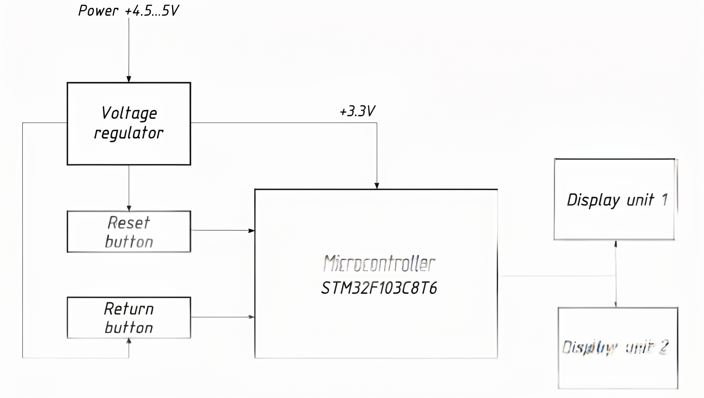
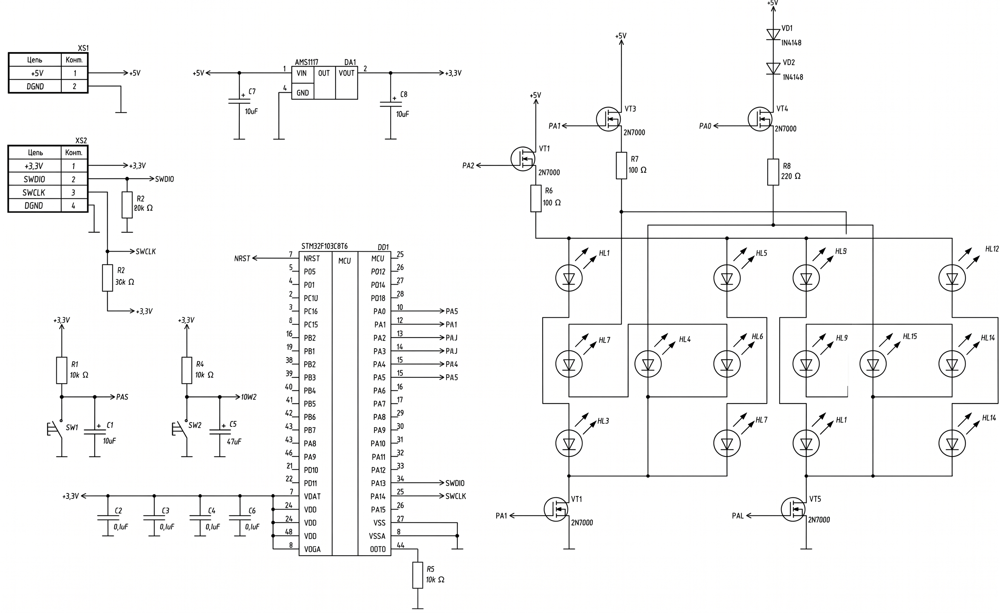
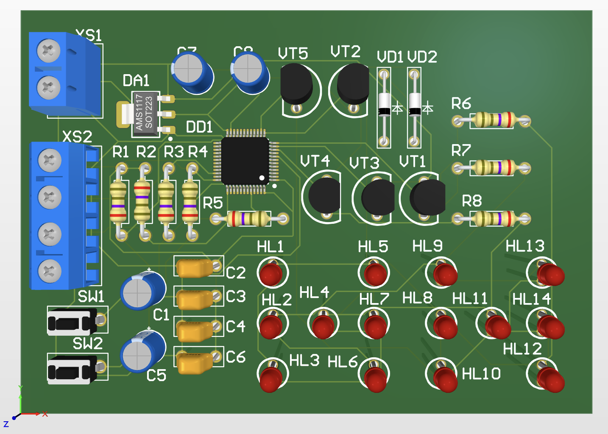
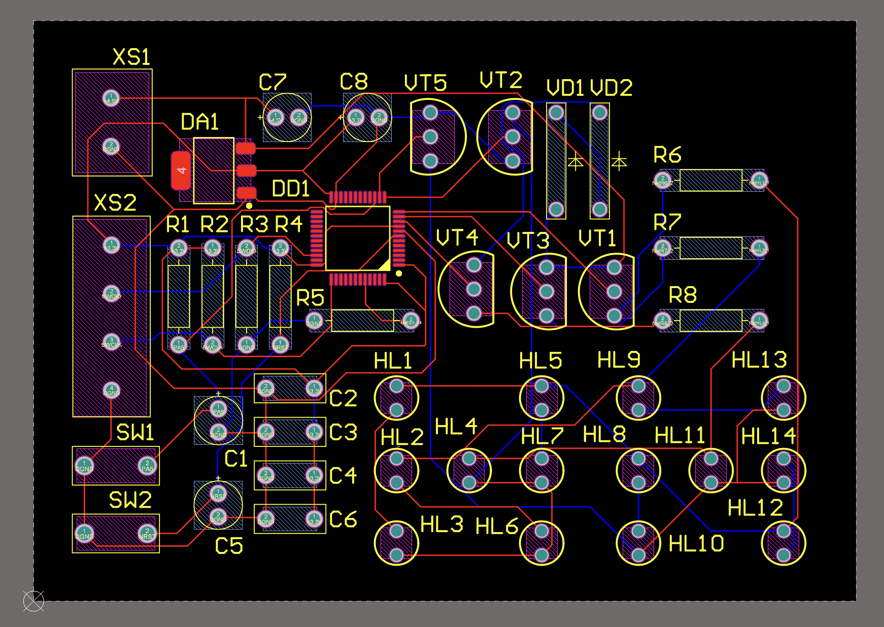
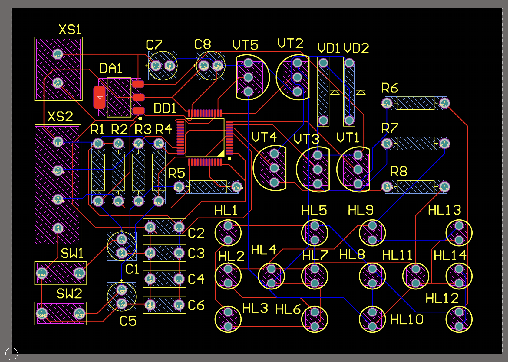
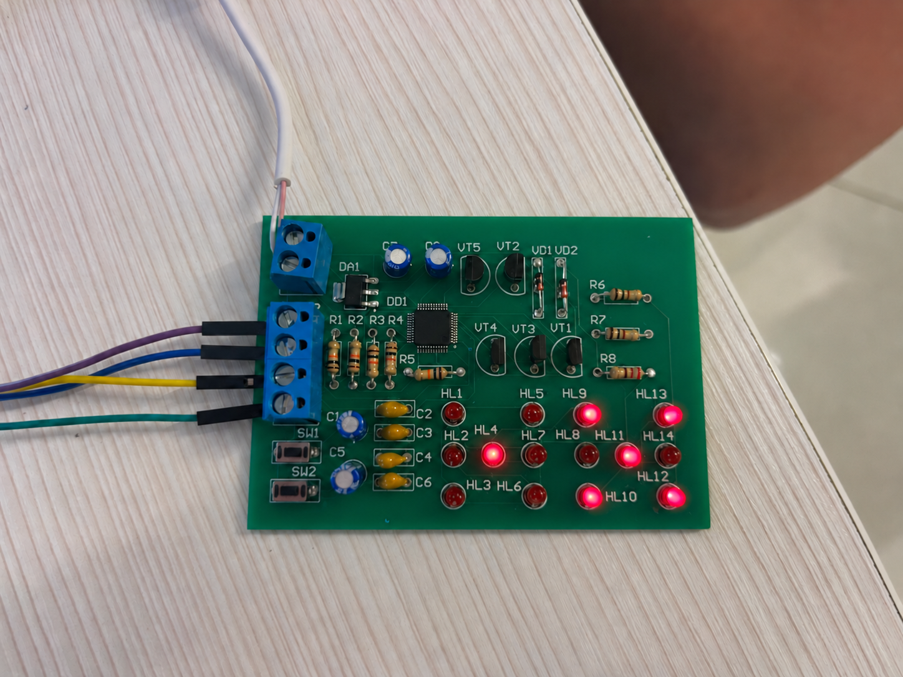

# STM32 Electronic Dice

An electronic dice device built around the **STM32F103C8T6** microcontroller. Fourteen LEDs form two dice displays. The device is designed to display random dice combinations, update them every five seconds, and recall the previous combination at the press of a button.

The repository contains the Altium Designer project, PCB views, fabrication files, BOM, and the original Russian engineering documentation.

## Block Diagram

The STM32 microcontroller reads the control buttons and drives the two LED display blocks. Power is supplied through the board’s power connector; the SWD connector is used for programming and debugging.

## Schematic

The schematic shows the STM32F103C8T6, 3.3 V regulator, LED drivers, two push buttons, power input, and SWD programming connector.

## PCB

### 3D View

### Top Layer

### Bottom Layer

The PCB is a **two-layer board**, **85 × 60 mm**. Components are mounted on one side. The design has 14 LEDs, two push buttons, and five 2N7000 MOSFETs.

## Assembled Device

The assembled board is shown above. The intended operating sequence is to display a random dice combination every five seconds. The return button recalls the previous combination; after five seconds, automatic updates resume.

## Bill of Materials

| Designators | Qty | Value / Part | Description | Manufacturer | Part Number | Package |
| --- | ---: | --- | --- | --- | --- | --- |
| C1, C7, C8 | 3 | 10 µF | Polarized capacitor | JB Capacitors | JYM1H104KBX020000B | ECAP |
| C2, C3, C4, C6 | 4 | 0.1 µF | Non-polarized capacitor | JB Capacitors | JRK1V100M02000500070000B | MLCC |
| C5 | 1 | 47 µF | Polarized capacitor | JB Capacitors | JRK1C470M02000500070000B | ECAP |
| DA1 | 1 | AMS1117-3.3 | 3.3 V linear voltage regulator | Advanced Monolithic Systems Inc. | AMS1117-3.3 | SOT-223 |
| DD1 | 1 | STM32F103C8T6 | 32-bit microcontroller | STMicroelectronics | STM32F103C8T6 | LQFP-48 |
| HL1–HL14 | 14 | GNL-3012HD | Light-emitting diode | G-nor Electronics | GNL-3012HD | THT |
| R1–R5 | 5 | 10 kΩ | Fixed resistor | Yageo | CF-1/4W-10KJ | CF-25 |
| R6, R7 | 2 | 100 Ω | Fixed resistor | Yageo | CF-1/4W-100RJ | CF-25 |
| R8 | 1 | 220 Ω | Fixed resistor | Yageo | CF-1/4W-220RJ | CF-25 |
| SW1, SW2 | 2 | KLS7-TS3601-5.0-180 | Push-button switch | KLS Electronics Co Ltd | KLS7-TS3601-5.0-180 | THT |
| VD1, VD2 | 2 | 1N4148 | Switching diode | YJ | 1N4148 | DO-53 |
| VT1–VT5 | 5 | 2N7000 | N-channel MOSFET | JCET | 2N7000 | TO-92 |
| XS1 | 1 | 2-pin, 5.0 mm | Power connector | KLS Electronics Co Ltd | L-KLS2-300-5.00-02P-2S | THT |
| XS2 | 1 | 4-pin, 5.0 mm | SWD programming connector | Ningbo Xinlaiya | XY300VA-5.0-4P-12 | THT |

[CSV BOM](docs/stm32-electronic-dice.csv) · [Altium BOM document](hardware/altium/stm32-electronic-dice_bom.BomDoc)

## Additional Notes

- The repository contains hardware and documentation files. Firmware source files are not included.
- The board can be powered from a **5 V supply** or **3.3 V from a programmer**, as described in the RPZ.

## Documentation (Russian)

- [E1 — Block diagram](docs/original-ru/stm32-electronic-dice_E1_block-diagram.PDF)
- [E2 — Functional diagram](docs/original-ru/stm32-electronic-dice_E2_functional-diagram.PDF)
- [E3 — Schematic](docs/original-ru/stm32-electronic-dice_E3_schematic.PDF)
- [PE3 — Parts list](docs/original-ru/stm32-electronic-dice_PE3_parts-list.pdf)
- [PP — PCB drawing](docs/original-ru/stm32-electronic-dice_PP_board-drawing.PDF)
- [SB — Assembly drawing](docs/original-ru/stm32-electronic-dice_SB_assembly-drawing.pdf)
- [SP — Product specification](docs/original-ru/stm32-electronic-dice_SP_specification.pdf)

## Fabrication Files

[Gerber archive](fabrication/stm32-electronic-dice_gerber.zip) · [STEP model](fabrication/stm32-electronic-dice.step) · [Altium project](hardware/altium/stm32-electronic-dice.PrjPcb)
